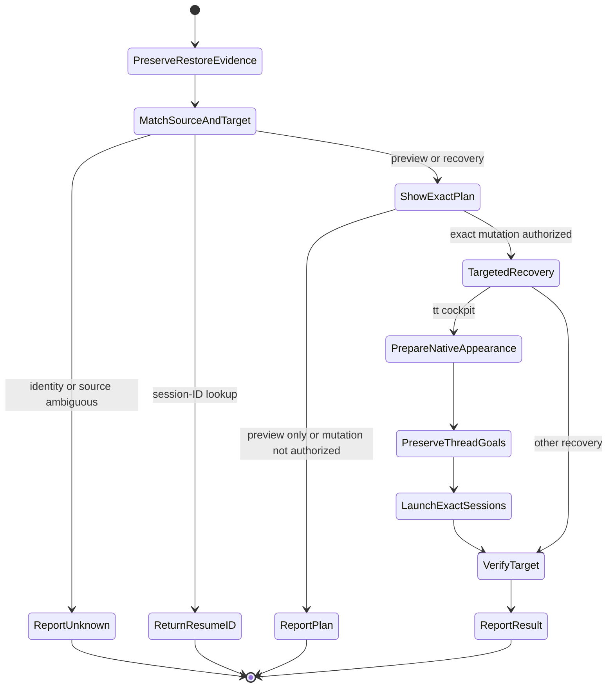

# Codex Session Recovery

## Purpose

Recover crashed, detached, or confusing agent sessions while preserving the best restore source.

## When to use

- Recover a Codex, Claude, or tmux cockpit session.
- Find an exact `codex resume <id>` command.
- Preview or restore saved pane/window/session state.
- Repair missing snapshot history or tmux menu bindings.

## Workflow

1. Preserve evidence before writing state.
   - Do not create a new snapshot until the restore candidate is known.
   - Do not run repair commands that overwrite history.
   - Set a recovery pane title when possible.
2. Inspect live tmux state.
   - `tmux display-message -p '#S:#I.#P #{pane_current_command} #{pane_current_path}'`
   - `tmux list-panes -a -F '#S:#I.#P #{pane_pid} #{pane_current_command} #{pane_current_path}'`
   - Inspect relevant key bindings before re-sourcing tmux configuration.
3. Inspect available recovery sources.
   - Prefer the operator's snapshot/history helper when installed.
   - For `tt` cockpit restoration, read [tt recovery](references/tt-recovery.md) and the snapshot directory's `AGENTS.md` before choosing a restore route. Install missing guidance from its dotfiles source; do not run a full bootstrap for this.
   - Inspect recent `~/.codex/sessions/YYYY/MM/DD/*.jsonl` metadata for session IDs and working directories.
   - Cross-check pane PIDs, cwd, and recent logs before selecting a session.
   - Inventory pane markers separately from terminal RGB support. A working palette does not prove the saved amber, green or other pane assignments survived. Match historical colors by exact session UUID and CWD when window numbers changed.
4. Produce a dry-run plan first.
   - Prefer one-pane or one-window restore over whole-session restore.
   - Show the snapshot or session ID, target pane, and exact command.
   - If the exact owners are already live, attach or repair only missing markers. Preview `tt marker restore <session> <snapshot>` when supported; preserve current conflicting markers. Do not rebuild or restart agents for missing pane colors.
5. Execute only with clear intent.
   - Require explicit intent before restore commands that mutate tmux state.
   - Never kill broad Codex, Claude, tmux, or terminal processes from name matches alone.
   - Restrict cleanup to the exact pane, PID, process group, or current-task resource.
   - For cockpit recovery, prepare the native RGB palette, saved pane markers and native agent launch environment before starting any Codex process. Restore the native three-column, two-row six-pane layout and verify rendered colors, not only live PIDs.
   - Preserve the original goals feature setting and each thread's goal lifecycle, objective, budget and usage. Do not add `--disable goals`, pause/clear goals, or issue blanket resume commands as part of restoration. Preserve native continuation of active goals; leave paused and terminal goals in their existing states.
6. Stay narrow for session-ID requests.
   - Return the concrete ID and `codex resume <id>` first.
   - Add the broader recovery method only when requested.

## Inputs

- Optional tmux pane or window target.
- Optional saved snapshot path.
- Optional mode: session-ID lookup, preview, targeted restore, or menu repair.
- Optional local snapshot helper such as `tt`.

## Outputs

- Exact resume command when available.
- Selected restore source and target.
- Dry-run restore plan before execution.
- Verified marker assignments and active/inactive styles, or an explicit missing-color evidence gap. PID counts alone do not establish a complete cockpit restore.
- Concise blocker when evidence is insufficient.

## Flow

