# Formal Math Conjectures

## Purpose

Give agents a reusable workflow for contributing to Lean 4 formal-mathematics projects: pick an unclaimed target, prove or formalize it, kernel-check it, and open a full pull request. The skill covers Google DeepMind's formal-conjectures, Left to Solve, and other confirmed projects, plus setup and policy rules that keep contributions reviewable.

## When to use

- The owner asks to work on Lean conjectures, formal-math problems, formal-conjectures, Left to Solve, Compfiles, or similar formalization projects.
- You need to resume or start a bounded batch of checked Lean contributions.
- You are choosing a project and need its AI policy, claim rules, and skip conditions.

Do not use this skill to open unsupervised PRs against Mathlib. Do not use it to publish solutions to evaluation benchmarks such as PutnamBench.

## Workflow

1. Confirm the owner's cap (default: a few problems; hold at most 2 Left to Solve leases at once). Do not start `tools/fleet.sh` or loop indefinitely unless the owner explicitly asks.
2. Set up Lean 4 only if this machine does not already have a working toolchain. See Setup below. Project-specific commands and policies are in `references/projects.md`.
3. Pick a project from that catalog. Prefer work the owner named; otherwise pick a project that still has unclaimed, policy-compatible targets.
4. **Pre-claim check.** Skip the target if anyone already has a solution or an in-flight PR. Search all of:
   - Open *and* closed pull requests and issues in the *target* repository (title, declaration name, OEIS id, Erdős number, file path).
   - Left to Solve's solved list (https://lefttosolve.com/solved) and merged pull requests in [GuillaumeBAUD-coder/open-math-agents](https://github.com/GuillaumeBAUD-coder/open-math-agents). A proof merged there counts as already solved, even when the same statement is still `sorry` upstream in `google-deepmind/formal-conjectures`. [formal-conjectures#8406](https://github.com/google-deepmind/formal-conjectures/pull/8406) duplicated statements already proved in open-math-agents; do not repeat that.
5. Expect easy and warmup items to be largely exhausted (on the order of 1,790 Left to Solve solves). Remaining useful work is typically research-level attempts, short test or variant lemmas that are not yet formalized anywhere, or `--kind formalize` tasks that state a problem exactly from its source. New formal-conjectures statements land frequently; sweep Left to Solve and the target repo soon after they merge, not only on a leisurely interval.
6. Claim or start work only after the pre-claim check is clean. Follow that project's claim protocol (comment to claim, `tools/oma.sh next`, and so on).
7. Prove or formalize on a branch off a freshly fast-forwarded default branch. For `open-math-agents`, fetch and fast-forward the owner's fork `main` from upstream before branching; the fork can lag by hundreds of commits. Keep the change scoped: one problem, or a tight cluster of tests and variants, per PR.
8. Check before opening a PR:
   - `lake build` the changed file(s).
   - No `sorry` or `admit` in changed declarations, unless the project is a statement repository and the leftover `sorry` is the intended open conjecture.
   - `#print axioms` of new proofs lists only `propext`, `Classical.choice`, and `Quot.sound`.
   - For Left to Solve, run `tools/oma.sh check` and beat the lease; release honestly (`too_hard` or the matching reason) rather than sitting on a stuck problem.
   - For a large lemma, split it with `tools/oma.sh reduce` (or the project's equivalent). Each reduction hypothesis must be self-contained: the Left to Solve linter forbids one hypothesis referencing another. Keep a `NOTES.md` per deep target. Prepare the proof file for each hypothesis before the reduction PR merges, so it can be submitted as soon as the steps exist.
9. Repeat the pre-claim check immediately before opening or submitting the PR; other agents race. Then open a **full** (non-draft) pull request. Disclose AI assistance the way that project requires. Do not write AI-authored review comments or Zulip messages. Track review and respond; do not open a second PR for the same target.
10. **Update the contribution catalogue.** After opening or merging a pull request, closing one, or posting a dead-end note, update [vincentkoc/solved-conjectures](https://github.com/vincentkoc/solved-conjectures). Pull the local clone with `git pull --ff-only`. Verify the status with `gh pr view` (or the Left to Solve note id) immediately before writing it. Run the catalogue's add-entry script to upsert the index and regenerate the README (columns: Project, Problem/step, Status, PR). Copy Lean files into the proofs directory for merged or open proofs (and for a superseded proof that is still ours). Do not put names, emails, timezone, location, or local paths in the catalogue; the public GitHub handle is enough, and dates are plain `YYYY-MM-DD`. Commit with signed commits and push `main`. The exact command is in [the catalogue update procedure](https://github.com/vincentkoc/solved-conjectures/blob/main/scripts/README.md).
11. After each merged or skipped item, stop when the batch cap is reached and report PR links, catalogue updates, skips and reasons, and any desk or CI blockers.

### Setup

- Install [elan](https://github.com/leanprover/elan), then use the repo's `lean-toolchain` and `lake`. After a clone or toolchain bump, run `lake exe cache get` for Mathlib. If that command stalls, fetch the cache files with parallel `curl` and retry; do not leave a half-written cache.
- Keep the Lean toolchain and Mathlib cache on a fast internal SSD, not a slow external drive. An `env.sh` that exports `ELAN_HOME`, `XDG_CACHE_HOME`, and `MATHLIB_CACHE_DIR` (and, for Left to Solve, `OMA_AGENT` and `OMA_MODEL`) is a good pattern. Example layout on a Mac: `~/formal-math/` for the toolchain, cache, and working clones.
- On macOS, GNU `timeout` is often missing from the default PATH, and Left to Solve's `tools/check.sh` needs it. From `env.sh`, add a directory that contains GNU `timeout` to `PATH` (for example `$FM/bin` if that is where you keep it).
- Tell the owner before the first multi-gigabyte download.

### Policies

- Only full, kernel-checked PRs. No drafts, and no PR that still has an accidental `sorry`.
- Skip a target when someone else already solved it or has an open PR, including proofs that landed in Left to Solve or `open-math-agents`. Repeat that check immediately before submit, not only before claim; other agents race.
- Cap the batch; hold at most 2 Left to Solve problems at once (tighter than the desk's cap of 5).
- Respect each project's AI policy and CLA. Mathlib bans unsupervised AI PRs — skip it. formal-conjectures follows Mathlib's disclosure rules; first-time contributors may wait on maintainer CI approval.
- Use the owner's GitHub noreply address and signed commits, set per repository only. Never disable `gpgsign` globally.
- After a public contribution (a PR opened, merged, or closed, or a dead-end note), update and push [vincentkoc/solved-conjectures](https://github.com/vincentkoc/solved-conjectures) the same day.

## Inputs

- Owner's target project or a request to keep working on formal math, plus any batch cap.
- A machine with `git`, `gh` signed in as the owner, and enough disk for Lean and the Mathlib cache (about 10 GB).
- Optional: existing clones, an `env.sh`, and the owner's preferred agent and model names for `OMA_AGENT` and `OMA_MODEL`.

## Outputs

- Full pull request URLs for checked contributions, or a clear skip with the conflicting PR or solved-list entry.
- A short batch report: what was attempted, what was skipped and why, Left to Solve desk status, and anything waiting on a maintainer.
- Honest lease releases when a Left to Solve problem is too hard.
- An updated, pushed entry in [vincentkoc/solved-conjectures](https://github.com/vincentkoc/solved-conjectures) for each opened, merged, or closed PR and each dead-end note.

## Flow

```mermaid
stateDiagram-v2
    [*] --> ConfirmCap
    ConfirmCap --> SetupCheck
    SetupCheck --> PickProject
    PickProject --> PreClaimCheck
    PreClaimCheck --> SkipTarget: already solved, open PR, or claimed
    SkipTarget --> PickProject: cap not reached
    SkipTarget --> Report: cap reached or no remaining targets
    PreClaimCheck --> DoWork: unclaimed and not already proved
    DoWork --> KernelCheck
    KernelCheck --> DoWork: build, sorry, or axiom failure
    KernelCheck --> ReleaseHonestly: stuck; Left to Solve lease
    ReleaseHonestly --> PickProject: cap not reached
    ReleaseHonestly --> Report: cap reached
    KernelCheck --> PreSubmitCheck: checks pass
    PreSubmitCheck --> SkipTarget: raced; already solved or claimed
    PreSubmitCheck --> OpenFullPR: still unclaimed
    OpenFullPR --> UpdateCatalogue
    UpdateCatalogue --> TrackReview
    TrackReview --> UpdateCatalogue: PR merged or closed
    ReleaseHonestly --> UpdateCatalogue: dead-end note posted
    UpdateCatalogue --> PickProject: cap not reached
    UpdateCatalogue --> Report: cap reached
    Report --> [*]
```

