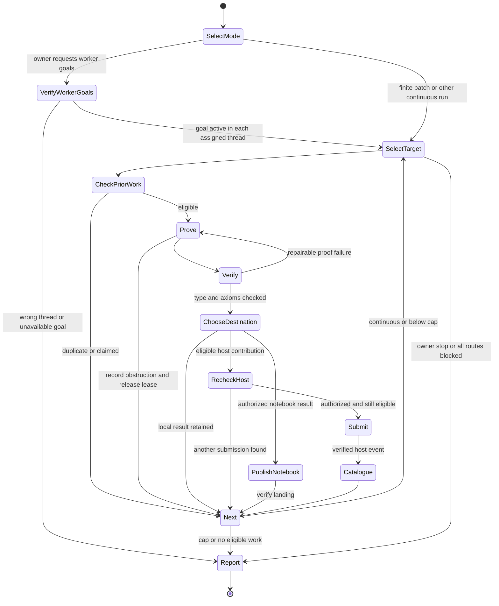

# Formal Math Conjectures

## Purpose

Select an unclaimed Lean 4 target, prove it or reduce it to a precise remaining question, and replay the result. Publish eligible work to the authorized notebook or host project.

## When to use

- The owner asks to work on Lean conjectures, formal-math problems, formal-conjectures, Left to Solve, Compfiles, or similar formalization projects.
- The owner asks to run, resume, or orchestrate a formal-math research campaign.
- You are choosing a project and need its AI policy, claim rules, and skip conditions.

Do not use this skill to open unsupervised PRs against Mathlib. Do not use it to publish solutions to evaluation benchmarks such as PutnamBench.

## Workflow

1. Use the requested cap, or start a small batch by default. An explicit request to keep working continually selects continuous mode. Start immediately and use the continuation rules below. Hold at most two Left to Solve leases across the campaign.
2. Set up Lean 4 only if this machine does not already have a working toolchain. See Setup below. Read the selected host’s [commands and policies](references/projects.md).
3. Pick a project from that catalog. Prefer work the owner named; otherwise pick a project that still has unclaimed, policy-compatible targets.
4. **Pre-claim check.** Skip the target if anyone already has a solution or an in-flight PR. Search all of:
   - Open *and* closed pull requests and issues in the *target* repository (title, declaration name, OEIS id, Erdős number, file path).
   - Left to Solve's solved list (https://lefttosolve.com/solved) and merged pull requests in [lefttosolve2/open-math-agents](https://github.com/lefttosolve2/open-math-agents). A proof merged there counts as already solved, even when the same statement is still `sorry` upstream in `google-deepmind/formal-conjectures`. [formal-conjectures#8406](https://github.com/google-deepmind/formal-conjectures/pull/8406) duplicated statements already proved in open-math-agents; do not repeat that.
   - If GitHub rejects the Open Math Agents repository qualifier, resolve its stable repository ID with `ghx --no-cache api repositories/1471973920 --jq .full_name` and repeat the search with the returned `repo:` value. A redirected PR URL can work even when search rejects the former name.
   - Look up the indexed declaration ID when a tracker returns `unknown_problem`. For example, Left to Solve drops Lean’s `«»` around arXiv identifiers. Confirm matches against the statement and the linked proof.
   - Inspect relevant open PRs on the host and linked proof projects at their head commits. Search their changed Lean files for the proposed helper or construction as well as the named target. GitHub’s default-branch code search can miss a proof embedded in a related PR. If a helper overlaps, credit it and choose a distinct remaining step.
5. For hard problems, read the pinned statement and its primary source. If the paper has changed, compare the pinned and revised claims clause by clause. When the target depends on a published theorem, also check later papers citing it. Read their current theorem statements and compare constants, assumptions and conclusions before choosing which bound to formalize. Cite the version and exact coverage, including a single inequality of a two-sided conjecture. Extend the strongest applicable result or isolate a missing hypothesis that would imply the target. Record the precise implication, construction or counterexample being attempted. Check the personal notebook and other workers’ assignments for overlap as well. Test values alone rarely advance a research question.
6. Claim or start work only after the pre-claim check is clean. Follow that project's claim protocol (comment to claim, `tools/oma.sh next`, and so on).
7. Prove or formalize on a branch off a freshly fast-forwarded default branch. For `open-math-agents`, fetch and fast-forward the owner's fork `main` from upstream before branching; the fork can lag by hundreds of commits. Keep the change scoped: one problem, or a tight cluster of tests and variants, per PR.
8. Check before opening a PR:
   - `lake build` the changed file(s).
   - No `sorry` or `admit` in changed declarations, unless the project is a statement repository and the leftover `sorry` is the intended open conjecture.
   - `#print axioms` of new proofs lists only `propext`, `Classical.choice`, and `Quot.sound`.
   - For Left to Solve, run `tools/oma.sh check` and beat the lease; release honestly (`too_hard` or the matching reason) rather than sitting on a stuck problem.
   - For a large lemma, split it with `tools/oma.sh reduce` (or the project's equivalent). Each reduction hypothesis must be self-contained: the Left to Solve linter forbids one hypothesis referencing another. Keep a `NOTES.md` per deep target. Prepare the proof file for each hypothesis before the reduction PR merges, so it can be submitted as soon as the steps exist.
9. For an authorized host submission, repeat the pre-claim check immediately before submitting. Open a **full** (non-draft) pull request when the result meets that host’s contribution rules. Disclose AI assistance the way that project requires. Do not write AI-authored review comments or Zulip messages. Track review and respond; do not open a second PR for the same target.
10. **Update the contribution catalogue.** After opening or merging a pull request, closing one, or posting a dead-end note, update [vincentkoc/solved-conjectures](https://github.com/vincentkoc/solved-conjectures). Pull the local clone with `git pull --ff-only`. Verify the status with `gh pr view` (or the Left to Solve note id) immediately before writing it. Run the catalogue's add-entry script to upsert the index and regenerate the README (columns: Project, Problem/step, Status, PR). Copy Lean files into the proofs directory for merged or open proofs (and for a superseded proof that is still ours). Do not put names, emails, timezone, location, or local paths in the catalogue; the public GitHub handle is enough, and dates are plain `YYYY-MM-DD`. Commit with signed commits and push `main`. The exact command is in [the catalogue update procedure](https://github.com/vincentkoc/solved-conjectures/blob/main/scripts/README.md).
11. Report the checked declaration, exact coverage, remaining gap and landed commit or PR. In a finite batch, stop at the cap. In continuous mode, take the next eligible step without awaiting a reply.

### Continuous research

- Resume from the live notebook, active branches, PRs and leases. Give each worker a distinct target, worktree and result directory. Keep the problem name, upstream revision and next mathematical question with its proof. If the owner names tmux panes, verify the current pane ID and foreground program, submit the literal assignment once, and confirm the worker received it. Never reconstruct a dispatch from shell history. Pass the verified pane ID explicitly to later commands such as `tt title "$pane_id" "workstream"` and `tt sync "$pane_id"`. Shells launched by a shared app server can inherit another client’s `TMUX_PANE`.
- When workers share a worktree lifecycle lock, give all lanes on that host the same queue or a separate campaign-owned lock for native enrollment and closeout commands. Keep proofs running in parallel. A busy enrollment can leave the new branch and checkout already registered. Inspect their state before retrying.
- When the owner requests a native `/goal` for workers, set it in each existing assigned thread. Check its thread ID, objective and active status. Give the goal the research scope and landing criteria, so a single merge leaves the campaign active. Once verified, retire any campaign-owned mechanism that sends continuation prompts to those threads. Keep ongoing proofs and PRs in place.
- Replay the saved Lean file using the pinned dependencies. When reusing a cache from a different checkout revision, verify the toolchain, dependency pins and relevant upstream sources. If a source differs, compile the pinned source in isolation before replay. Check the theorem’s type against the upstream definitions, its quantifiers and its axioms. Distinguish a solved host declaration, a known theorem newly formalized, a conditional implication and a partial bound.
- For a module with several claimed results, match each full declaration name to its `#print axioms` report, including trailing primes such as `f'`. If a report is missing, query that declaration from the compiled module and check its axiom list before landing.
- For a notebook proof, set `runner="$PWD/scripts/replay-research"` at the notebook root. From the pinned Formal Conjectures checkout, run `lake env python3 "$runner" ModuleName`. Supply the filename stem of each result you changed. The runner discovers its imports, rebuilds the closure and checks each compiled module in a fresh kernel process. Omit module names for a full notebook replay. For separate dependencies checked with `leanchecker -v`, run one name at a time and inspect the matches. Lean 4.33.1 treats CLI names as prefixes.
- For a slow bounded quantifier such as `∀ s ∈ candidates, P s`, inspect `#synth Decidable (...)`. Lean can select `Fintype.decidableForallFintype` and enumerate the whole type. For a finset, give `Finset.decidableDforallFinset` local priority at that proof and replay it. In a sixteen-coordinate cube this reduced one check from all 65,536 subsets to the 28 six-subsets of a specified hyperplane.
- If a finite-search certificate strains memory during kernel conversion, split the search into small subtree lemmas. Prove each leaf and combine every child result into its parent inside Lean. Replay the root theorem that connects the exhaustive search to the mathematical statement. [Worked certificate](https://github.com/vincentkoc/solved-conjectures/blob/56839761e078c8a160b124970a080efb6ff315c8/research/arxiv/1104.1579/CunninghamJonesEightySixCertificate.lean)
- Publish to the destination the owner authorized. A checked partial result or long proof can live in the personal notebook under `research/`. Give it a replay command and describe the missing step. Reserve catalogue statuses for actual host events. A notebook merge alone does not establish the upstream conjecture. Follow the host’s current link/registry policy when a proof covers its declaration.
- When landing is authorized, use the destination’s merge workflow. Record the remote default-branch tip once. Verify the merged commit is its ancestor and compare the landed proof files at that tip. For a shared notebook index, compare the contribution’s exact row so concurrent insertions can land independently. Read Git objects from the canonical owner. If an observed commit is missing locally, fetch its exact ID there with `--no-write-fetch-head --no-tags --no-prune`. While a result waits on external review, another independent eligible target can proceed.
- When a restricted case yields a numerical bound, use extremal examples to test the constant against the original quantifiers. If the proof needs a structured subset, state its required size and test whether every input supplies it. If an example rules out one constant but the conjecture allows larger ones, strengthen the obstruction or record the surviving range and continue on another target. State exactly which conclusion the example excludes. For instance, a sumset that misses one vector can still contain a large affine subspace.
- After a landing, duplicate or concrete obstruction, release any obsolete lease and select the next research question. Retry a failed approach when new evidence changes it. The coordinator monitors actual worker turns, reuses confirmed free lanes, and stops on owner request, exhaustion of eligible targets, or a blocker affecting every remaining route. Report the last verified outcome and the exact unblock action when applicable.

### Setup

- Install [elan](https://github.com/leanprover/elan), then use the repo's `lean-toolchain` and `lake`. After a clone or toolchain bump, run `lake exe cache get` for Mathlib. If that command stalls, fetch the cache files with parallel `curl` and retry; do not leave a half-written cache.
- Keep the Lean toolchain and Mathlib cache on a fast internal SSD, not a slow external drive. An `env.sh` that exports `ELAN_HOME`, `XDG_CACHE_HOME`, and `MATHLIB_CACHE_DIR` (and, for Left to Solve, `OMA_AGENT` and `OMA_MODEL`) is a good pattern. Example layout on a Mac: `~/formal-math/` for the toolchain, cache, and working clones.
- On macOS, GNU `timeout` is often missing from the default PATH, and Left to Solve's `tools/check.sh` needs it. From `env.sh`, add a directory that contains GNU `timeout` to `PATH` (for example `$FM/bin` if that is where you keep it).
- Tell the owner before the first multi-gigabyte download.

### Policies

- Only full, kernel-checked PRs. No drafts, and no PR that still has an accidental `sorry`.
- Skip a target when someone else already solved it or has an open PR, including proofs that landed in Left to Solve or `open-math-agents`. Repeat that check immediately before submit, not only before claim; other agents race.
- Respect each project's AI policy and CLA. Mathlib bans unsupervised AI PRs — skip it. formal-conjectures follows Mathlib's disclosure rules; first-time contributors may wait on maintainer CI approval.
- Use the owner's GitHub noreply address and signed commits, set per repository only. Never disable `gpgsign` globally.
- After a public contribution (a PR opened, merged, or closed, or a dead-end note), update and push [vincentkoc/solved-conjectures](https://github.com/vincentkoc/solved-conjectures) the same day.

## Inputs

- Owner's target project or a request to keep working on formal math, plus any batch cap.
- A machine with `git`, `gh` signed in as the owner, and enough disk for Lean and the Mathlib cache (about 10 GB).
- Optional: existing clones, an `env.sh`, and the owner's preferred agent and model names for `OMA_AGENT` and `OMA_MODEL`.

## Outputs

- Full pull request URLs for checked contributions, or a clear skip with the conflicting PR or solved-list entry.
- A short batch report: what was attempted, what was skipped and why, Left to Solve desk status, and anything waiting on a maintainer.
- Honest lease releases when a Left to Solve problem is too hard.
- An updated, pushed entry in [vincentkoc/solved-conjectures](https://github.com/vincentkoc/solved-conjectures) for each opened, merged, or closed PR and each dead-end note.

## Flow

