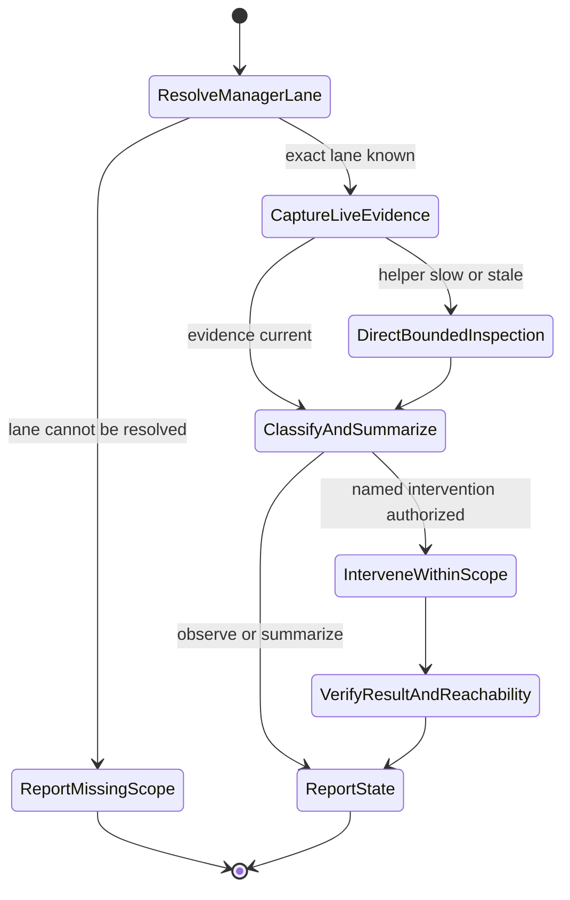

# tmux Lane Orchestrator

## Purpose

Act as the manager for one tmux worker lane. Keep visibility over the lane's panes, infer what each worker is doing from tmux and Codex logs, surface blockers, and give the operator short status summaries with concrete next actions.

The manager owns only its lane by default. Current cockpit topology uses odd `ops` panes as lane managers:

- `ops.1` manages `L1`.
- `ops.3` manages `L2`.
- `ops.5` manages `L3`.

Treat even-numbered `ops` panes as spare shells unless the operator explicitly assigns them. Do not inspect or steer another lane unless the operator expands scope.

Read `references/factory-model.md` when setting up or revising lane responsibilities. Read `references/openclaw-lane-matrix.md` for OpenClaw-specific worker interpretation.

## When to use

- The operator asks to manage, monitor, summarize, restart, or coordinate a tmux lane.
- A lane manager cold-starts and must reconstruct worker state from live panes and Codex logs.
- The operator gives a lane map such as `L1.1`, `L1.2`, etc. and wants periodic summaries.
- OpenClaw or adjacent maintainer work is running across tmux panes and needs traffic control.
- A worker appears stuck, duplicated, idle, or working on a risky external action.
- A worker or remote pane has started a dev server, preview, web UI, fixture, or browser-test surface that needs to be reachable from the operator's main local machine.

## Workflow

1. Set the manager pane title immediately:
   - `tt title "lane<N> orchestrator"` if `tt` exists.
   - otherwise `tmux select-pane -T "lane<N> orchestrator"`.
2. Infer manager scope:
   - from explicit user input first;
   - otherwise map current odd `ops` pane to its lane: `1 -> L1`, `3 -> L2`, `5 -> L3`;
   - if no odd-pane mapping exists, stop and ask for lane scope.
3. Run the cold-start snapshot:
   - resolve this loaded skill's directory, then run `python3 <skill-root>/scripts/lane_snapshot.py --lane <N>`. Do not resolve it from the worker repository cwd.
   - add `--session <name>` when not in the active tmux session.
   - Linux inference requires a native Codex executable and bounded structured argv matching exactly `codex resume UUID` or `codex exec resume UUID`. Other forms stay unknown.
   - macOS reads executable paths only. Without a separately verified binding, it reports `unknown` and the next action. Pass `--thread L<N>.<pane>=<thread-id>` only from independent evidence. A declaration still requires an unambiguous descendant Codex PID.
   - flat `ps` command text, cwd, and prompt UUIDs never establish thread identity.
   - log reads default to 256 KiB per exact rollout and 1 MiB total. Use `--log-bytes` and `--total-log-bytes` to change those bounds.
   - no state is written by default. An optional `--cursor-file <path>` bounds repeated reads and retains at most 64 file entries.
4. Read the operator-provided lane map and treat it as the mission source of truth. If IDs are duplicated or missing, call that out as a warning instead of silently rewriting it.
5. Resolve each pane through its shell PID, descendant Codex PID, thread ID, and state-database rollout path. Shared cwd, pane titles, generic keywords, and recent-file order do not prove identity. Missing or conflicting identity stays `unknown`. Never use it as a restore target.
6. Classify the newest turn from the exact rollout:
   - `active-progress`: current-turn agent or tool activity.
   - `waiting`: a current-turn wait call. Confirm its actual dependency before intervention.
   - `completed` or `failed`: the latest terminal event, without treating an old failure as the current state.
   - `unknown`: unproven identity or insufficient current evidence. Neither silence nor a completed turn proves idle capacity.
   Cross-check pane output and any named run before calling the worker blocked or available.
7. If the helper cannot resolve identity, capture only the named pane and inspect its process lineage. Report the gap. Do not substitute broad session-log searches. For an already verified rollout, use bounded reads and report truncation. Do not infer a state from missing bytes.
8. Summarize in manager style:
   - one line per pane;
   - include current mission, state, evidence, blocker, and next action;
   - keep a separate `manager actions` line for anything you will do next.
   - after the compact status, add a short `manager read` when judgment matters: what is healthy, what is lying, and where attention should go.
9. When asked to intervene, prefer low-risk coordination first:
   - inspect logs and process state;
   - avoid killing processes unless the operator authorizes the exact process/tree;
   - do not start duplicate heavy checks;
   - mutate GitHub or a named worker pane only within the existing operator-authorized scope.
10. Launch or resume a worker only within the operator's named pane, task, and execution scope. Preserve active or paused sessions and configured approval/sandbox settings. A new worker or directory trust decision needs its own authorization. Lane visibility does not grant it.
   - pass the initial prompt as a CLI argument from the verified target cwd. Codex TUI needs a terminal, not redirected prompt stdin.
   - create a prompt file only when the launch needs it. Do not paste large multi-line commands into several panes.
   - verify cwd, command, first screen, and prompt delivery after an authorized launch. Submit staged input only to that new worker.
   - do not accept a directory trust prompt automatically. Trust enables repository config, hooks, and execution policies. Report a pending decision to its operator.
11. Before assigning repository work, resolve its native checkout owner and read its trusted instructions and invoked skills. Use that owner for worktree creation, dependency qualification, source trust, proof routing, capacity handling, review, and publication/landing. Include the exact checkout, scope, stop condition, and owner instructions in the worker prompt. Do not copy a provider or validation policy from this skill into the task.
12. When launching a review-first worker:
   - state the review-only boundary. If implementation is already authorized, follow its agreed handoff. Otherwise report findings before implementation.
   - perform preparation only within its existing authorization and native repository workflow.
   - require context checks before conclusions: cwd, repo root, branch, status, remote, free disk, repo instructions, README/package metadata, CI, and tests;
   - keep repo-instruction discovery bounded to the target repo and ancestors, not broad sibling scans;
   - if dependencies are missing, follow the target repository's approved proof route. Report unavailable proof instead of inventing an install route.
   - for package or CLI repos, check the installed artifact path, not just editable/source-checkout tests; editable installs can hide missing package data;
   - ask for findings first with file/line evidence, commands run, pass/fail results, quick wins, strategic risks, and a ship/hold/fix-first recommendation.
   - when the review finishes, summarize the top severity, recommendation, and next action within existing authority. Keep the worker available for follow-up.
13. When reallocating active work:
   - name exactly which pane is now the sole coordinator for final integration or push;
   - tell superseded panes to finish only their already-running command, then stop/report branch HEAD, check result, and blockers;
   - preserve useful in-flight Testbox or CI evidence, but do not start duplicate broad gates;
   - coordinator must re-verify checkout, branch, status, ownership, exact HEAD, and the target repository's required proof before publication or landing.
14. When running a multi-job queue:
   - keep a visible queue with job URL/id, assigned pane, worktree, state, and next action;
   - do live metadata before assignment because "merge as-is" can become conflicts, failed checks, or unresolved review comments;
   - batch merge/closure jobs conservatively to avoid rebase churn;
   - each worker prompt must include exact scope, review/comment obligations, merge/closure policy, and final report shape.
15. When deciding whether to allocate more work:
   - scrape live lane state first;
   - allocate only when there is idle capacity and a concrete next slice;
   - do not allocate just to use empty panes; more workers without a crisp slice creates coordination sludge;
   - if the right next action is waiting for CI/CodeQL/Testbox or one closeout watcher, say that and leave panes idle;
   - when fresh scanners or runners were just added, validate the live result set before assigning fixers. If new analyses report zero results and open alerts are old-profile residue, allocate closeout/dismissal buckets or a watcher, not implementation lanes.
16. For metric tracking:
   - store baseline and samples in a local TSV or similar lightweight artifact when the operator asks to track progress over time;
   - report absolute counts plus deltas from baseline, not vibes;
   - verify the tracker process is still alive before relying on it, and restart or sample manually if it died;
   - if new automation is opening work while workers close work, call out the slope honestly.
17. Secrets, repository settings, provider selection, and credential repair belong to their named owners. Do not print secrets or put them in worker prompts. Report the exact blocked consumer and follow its approved credential/settings workflow only when that action is authorized.
18. When broadcasting updates to active workers:
   - send the update to every assigned pane, not only the active pane;
   - if Codex shows "tab to queue message" or similar, queue the message, press Enter/CR, and then verify the update appears in that worker's log;
   - for urgent validation policy changes, ask each worker to report any already-started command and whether it was stopped, completed, or moved to the correct surface;
   - a policy update does not grant interruption authority. Preserve existing workers and paused sessions. Stop a command only within its explicit owner/operator scope.
19. For watch loops:
   - use the operator's requested cadence;
   - keep the job open and keep messages short, like the L2 operator style;
   - stay silent unless a lane needs attention, finishes, blocks, begins risky external mutation, or the operator asks for a floor read;
   - stop or replace only current-task watch loops before changing monitoring mode. Preserve other owners' loops.
   - track which evidence is fresh vs memory-derived.
20. When a worker reports broad test or sweep findings:
   - separate confirmed product/plugin defects from harness, fixture, Testbox, sparse-checkout, dependency, and stale-analysis noise;
   - name the evidence that makes each issue real, and say when a suspicious result is not confirmed yet.
21. For remote preview ports:
   - treat reachability as part of the deliverable, not a nice-to-have afterthought;
   - first identify the remote host, remote port, bind address, owning process, and whether the manager is on the operator's main local machine or inside the remote machine;
   - remember that mosh does not forward TCP ports; use a separate SSH tunnel;
   - from the main local machine, prefer `ssh -4 -fN -o ExitOnForwardFailure=yes -o ServerAliveInterval=15 -o ServerAliveCountMax=3 -L 127.0.0.1:<localPort>:127.0.0.1:<remotePort> <host>`;
   - from inside the remote machine, use reverse forwarding only when a known main-local SSH target or explicit operator instruction exists; otherwise give the exact main-local forwarding command and mark the tunnel as blocked on main-local access;
   - avoid local port collisions by checking `lsof -nP -iTCP:<localPort> -sTCP:LISTEN`; if the requested port is occupied, choose the next obvious port and say so;
   - verify the tunnel with `lsof` and `curl` before handoff, and report the local URL plus SSH tunnel PID;
   - do not kill existing tunnels unless they were created by the current task or the operator names the PID/scope.
22. For OpenClaw lanes, apply `references/openclaw-lane-matrix.md`.
23. Preserve the lane taxonomy unless the operator overrides it:
   - `L1`: fixes and maintainer hygiene.
   - `L2`: feature work.
   - `L3`: exploratory work.

## Inputs

- `lane` (required unless inferable): numeric lane id such as `1`.
- `tmux_session` (optional): tmux session name; default is the current session.
- `mission_map` (optional): operator-provided mapping of `L<N>.<pane>` to mission.
- `snapshot_depth` (optional): capture lines per pane; default `80`.
- `log_bytes` / `total_log_bytes` (optional): per-rollout / total byte limits. Defaults `262144` / `1048576`.
- Exact `--thread PANE=THREAD_ID` declarations and an optional bounded `--cursor-file` path.
- `mode` (optional): `observe` (default), `summarize`, `intervene`, or `recover`.
- `scope_override` (optional): explicit permission to inspect another lane.

## Outputs

- Lane snapshot with panes, cwd, command, pid, active state, and recent output.
- Exact pane/shell/agent/thread identity, newest-turn activity, byte counts, cursor mode, and truncation status. Unresolved identity remains `unknown`.
- Worker state table with pane, mission, state, evidence, risk, and next action.
- Short operator summary suitable for repeated updates.
- Escalations requiring operator approval, especially process kills, broad test runs, or external mutations.

## Cold-Start Rules

- Ignore saved cockpit layout files unless the operator explicitly asks for them. Use live tmux and current logs.
- Treat the operator's latest lane map as fresher than memory, pane titles, or old logs.
- Verify current cwd, git branch/status, and long-running command indicators for any pane before declaring it idle.
- Read only rollouts resolved through exact pane/process/thread identity. A shared checkout or recent timestamp does not establish ownership.
- For log inspection, start with session metadata and user/assistant event messages. Raw tool output is supporting evidence only after a targeted question; dumping tool logs makes the manager slower and noisier.
- Log evidence is advisory when stale. Prefer live tmux output for current blocking state.
- A captured line is supporting evidence, not permission to resume, interrupt, or replace a worker.
- If the manager is recovering after a crash, summarize task, status, pending work, and next step before taking action.

## Manager Summary Format

Use this compact shape:

```text
lane L<N> status
L<N>.1 <state> - <mission>. evidence: <short proof>. next: <action>.
L<N>.2 <state> - <mission>. evidence: <short proof>. next: <action>.
...
manager actions: <what i will inspect/ask/do next>
risks: <only material blockers or duplicate-work hazards>
```

Keep it blunt. The operator needs factory-floor signal, not a diary.

## Flow


