# X Release Post

## Purpose

Turn a shipped release into a short X post, with an optional install reply, that matches the format of Vincent Koc's tokenjuice launch posts. Every claim comes from the release itself.

## When to use

- A release, version bump, or milestone is published and needs an announcement on X.
- The user asks for a release post, launch post, or "post this on X" draft for a project.

Do not use it to post, schedule, or reply on X. Posting is a separate action that needs the user's approval of the exact text.

## Workflow

1. Confirm the release exists. Read the GitHub release, `CHANGELOG.md` entry, or tag, and note the version and link. If the release is not published, draft only on request and mark the draft unreleased.
2. Read the full delta: `git log --oneline <previous-tag>..<tag>` or the compare view. A version jump that spans several releases (for example 0.4 to 0.6.1) gets the range in the hook.
3. Pick 3-6 user-facing highlights. Prefer new integrations, platforms, and visible fixes or speedups. Drop refactors, CI, dependency bumps, and internal tests. Merge small related items into one line.
4. Collect facts for numbers. Use only figures from the release, benchmarks in the repo, or registry counts the user supplies. Do not estimate downloads, savings, or speedups.
5. Find handles for credited tools and partners. Use an @-mention only when the handle is confirmed on X; otherwise use the plain name. Keep mentions to the ones the release ships.
6. Write the draft with the template below. Read `references/examples.md` for the real posts and what performed.
7. Check length: `python3 scripts/x-post-length draft.txt`. Separate thread posts with a line containing only `---`. Each post must report `ok` for 280. Use `--limit 25000` only when the user confirms the account can post long-form; even then keep the main post short.
8. Return the draft and the length report. Ask the user to approve or edit the exact text. Do not post, schedule, or reply.

## Template

```text
<project> <🧃 project emoji> (vX.Y.Z) is out!

<emoji> <highlight 1, user-facing, under ~50 chars>
<emoji> <highlight 2>
<emoji> <highlight 3>
<emoji> <optional highlights 4-6>

<one-line call to action> <release or repo link>
```

Optional reply, posted as a thread under the main post:

```text
<one sentence on how it works>

Run:
- <install command>
- <setup command>
```

Rules:

- Hook: project name, version, and the project's signature emoji in the first line. Vary the verb: "is out!", "released!", "new version out (0.4->0.6.1):".
- One emoji per bullet, matched to the content (🐧 Linux, 🪟 Windows, 🦞 OpenClaw, ⚙️ rules or config, 🥳 new integrations). No `-` or `*` bullets in the main post.
- Lead with the strongest line. A short metaphor that explains the value ("Ozempic for your shell toolcalling") works better than a feature name.
- Group integrations into one line of @-mentions plus "and more". Do not list a long series of names in prose.
- Casual first person, lowercase is fine, exclamation in the hook only. No hashtags. Spell-check: the source posts contain typos; the drafts should not.
- One link, at the end. Prefer the release page for a version post and the repo for a launch.
- Milestone posts (installs, downloads, stars) are separate from version posts: one or two sentences, the number, the project age, and an image of the chart if the user has one.

## Inputs

- Project name, signature emoji, and repository URL.
- Release tag and previous tag, or the release notes or `CHANGELOG.md` entry.
- Optional: install commands, confirmed X handles for credits, verified metrics for a milestone post.

## Outputs

- Main post text and optional thread reply, ready to copy.
- Length report from `scripts/x-post-length` for each post.
- Notes on anything left out or unverified (for example an unconfirmed handle).

## Flow

```mermaid
stateDiagram-v2
    [*] --> ReadRelease
    ReadRelease --> AskForNotes: release or notes missing
    ReadRelease --> PickHighlights: release verified
    AskForNotes --> [*]
    PickHighlights --> DraftPost
    DraftPost --> CheckLength
    CheckLength --> DraftPost: a post is over the limit
    CheckLength --> ReturnDraft: every post ok
    ReturnDraft --> [*]: user approves or edits; posting is separate
```


